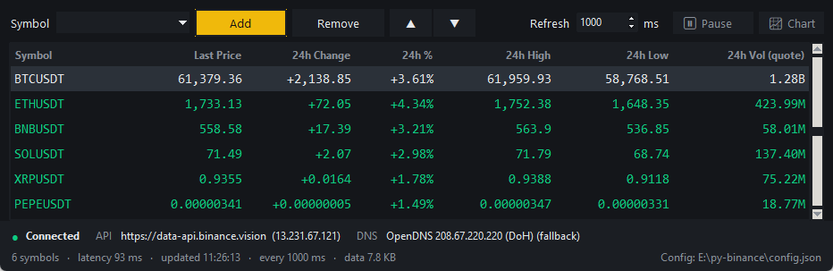
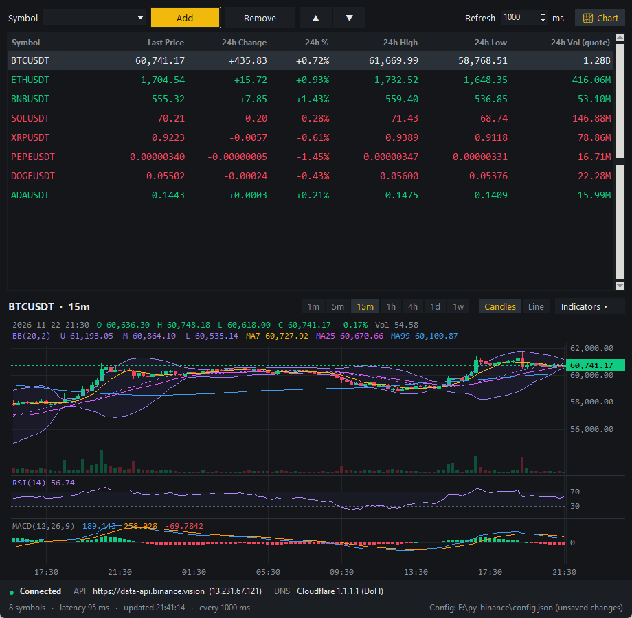
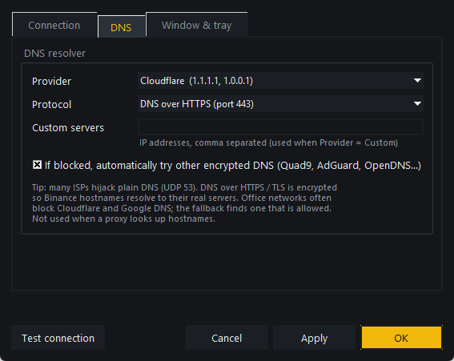
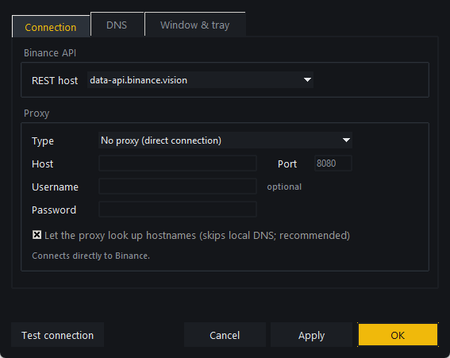
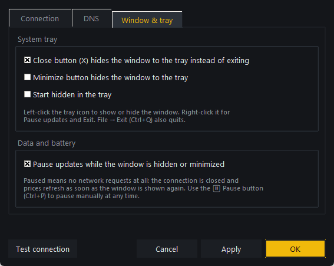

# Binance Price Viewer

**Fast, dependency-free Python desktop app for live Binance spot prices — favorites list, candlestick charts with Bollinger Bands / MA / EMA / RSI / MACD, encrypted DNS (DoH / DoT) with automatic fallback, HTTP / SOCKS5 proxy support, a system tray icon and a data-saving pause.**

Pure Python standard library (Tkinter + `http.client`): no `pip install`, starts in under a second.



## Features

- **Live prices for your favorite tickers**: last price, 24h change / %, high, low and quote volume. All favorites are fetched in one batched request over a keep-alive HTTPS connection on a background thread, so the UI never freezes. Refresh interval is adjustable down to 250 ms.
- **Favorites management**: add symbols with autocomplete (`BTC` → `BTCUSDT`), remove, reorder (▲/▼), sort by any column. Rows flash green/red when the price changes.
- **Price chart** (toggle with the **Chart** button or `Ctrl+G`, off by default)
  - Candles or line, intervals 1m / 5m / 15m / 1h / 4h / 1d / 1w
  - Indicators: **Bollinger Bands (20, 2)**, MA (7/25/99), EMA (12/26), Volume, RSI (14), MACD (12, 26, 9)
  - Crosshair with OHLC and indicator values, mouse-wheel zoom, live-updating last candle
- **Custom DNS resolver**: Cloudflare 1.1.1.1 (default), Google, Quad9, AdGuard, OpenDNS, system DNS or your own servers. Uses DNS over HTTPS, DNS over TLS or plain UDP. If the chosen resolver is blocked (common on office networks), it **automatically falls back** to another encrypted resolver.
- **Proxy support**: HTTP (CONNECT) or SOCKS5 proxy with optional username and password, or the Windows system proxy. By default the proxy looks up hostnames, so no local DNS is needed.
- **System tray**: closing the window hides it to the tray instead of exiting. The tray tooltip shows your top prices. Left-click the icon to show or hide the window; right-click it for **Pause updates** and **Exit**.
- **Pause updates** (toolbar button or `Ctrl+P`): no network requests at all while paused. Updates also pause automatically while the window is hidden or minimized, to save data and battery.
- **Connection info bar**: connection state, API host and server IP, proxy route, and the DNS server that answered.
- **Save / load configuration** as JSON in the app folder (`config.json` loads automatically on startup).
- Dark theme, high-DPI aware, custom app icon.



## Download (Windows exe)

Get **`BinancePriceViewer.exe`** from the [latest release](https://github.com/richardyusan/py-binance-price/releases/latest). It's a single file and doesn't need Python. Put it in any folder and run it. `config.json` is saved next to the exe.

> The exe isn't code-signed, so Windows SmartScreen may show "Windows protected your PC". Click **More info → Run anyway**, or run from source as described below.

## Requirements (running from source)

- Windows 10/11 (also runs on macOS/Linux with Python + Tk)
- [Python 3.9+](https://www.python.org/downloads/) with **tcl/tk** and the **py launcher**. Both are selected by default in the Windows installer.

No third-party packages are needed.

## Getting started (Windows)

```powershell
git clone https://github.com/richardyusan/py-binance-price.git
cd py-binance-price
```

Then start it any of these ways:

| Launcher | What it does |
|---|---|
| `BinancePriceViewer.pyw` | Double-click: runs through the Python launcher (`pyw`) without a console window |
| `run.bat` | Same, from a terminal or Explorer. `run.bat --console` keeps a console open for error output |
| `create_shortcut.ps1` | Creates Desktop and Start Menu shortcuts with the app icon |
| `py binance_viewer.py` | Run directly |

```powershell
powershell -ExecutionPolicy Bypass -File create_shortcut.ps1
```

### Building the exe

```powershell
powershell -ExecutionPolicy Bypass -File build_exe.ps1
```

The script installs PyInstaller into an isolated `.venv-build`, embeds the icon and version info, and writes `dist\BinancePriceViewer.exe` and `dist\BinancePriceViewer-<version>-win64.zip`.

## Usage

| Action | How |
|---|---|
| Add a favorite | Type a symbol in **Symbol** and press Enter or click **Add** |
| Remove / reorder | Select rows, then **Remove** / Delete key, or ▲ ▼ |
| Sort | Click a column header (click again to reverse) |
| Show chart | **Chart** button, **View → Show chart** or `Ctrl+G`, then click a ticker |
| Pause / resume updates | **⏸ Pause** button, **View → Pause updates** or `Ctrl+P` |
| Hide to tray | Close the window (X). Click the tray icon to bring it back |
| Exit | **File → Exit** (`Ctrl+Q`) or right-click the tray icon → **Exit** |
| Indicators | **Indicators ▾** in the chart toolbar |
| Zoom chart | Mouse wheel over the chart |
| Open on binance.com / copy price | Double-click a row, or right-click for the menu |
| Save / load config | `Ctrl+S`, `Ctrl+Shift+S`, `Ctrl+O` (File menu) |
| Connection, proxy, DNS and tray settings | **Settings** menu or `Ctrl+,` |
| Refresh now | `F5` |
| About | **Help → About** or `F1` |

## Connection, proxy & DNS settings



Many ISPs block Binance by **hijacking DNS**: every lookup on port 53 is intercepted and answered with a block-page address, even when you query 1.1.1.1 directly. The app therefore resolves Binance hostnames itself through an **encrypted** resolver and then connects to that IP, still verifying the TLS certificate against the real hostname.

| Protocol | Notes |
|---|---|
| DNS over HTTPS (default) | `https://<resolver-ip>/dns-query` (RFC 8484). Falls back to DoT |
| DNS over TLS | Port 853 (RFC 7858). Falls back to DoH |
| Plain DNS (UDP 53) | Fast, but easily hijacked. Never used as an automatic fallback |

Quad9 only accepts HTTP/2 for DoH, so the app uses DoT for it automatically.

**Automatic fallback** (on by default): office and campus firewalls often block the well-known resolvers such as 1.1.1.1 and 8.8.8.8 outright. If the chosen provider hasn't answered within 1.5 s, the app also queries Cloudflare, Quad9, AdGuard, OpenDNS and Google over DoH / DoT in parallel. It uses the first real answer and keeps using that provider. The status bar then shows, for example, `Quad9 9.9.9.9 (DoT) (fallback)`. Plain UDP is never used for fallback. Turn it off with the **If blocked, automatically try other encrypted DNS** checkbox.

API hosts:
- `data-api.binance.vision` (default): Binance's public market-data endpoint
- `api.binance.com` / `api1-4.binance.com`: main API
- `api.binance.us`: Binance.US

### Proxy



**Settings → Connection & proxy** supports:

| Type | Notes |
|---|---|
| No proxy (default) | Direct connection |
| Windows system proxy | Uses the proxy set in Windows Settings → Network → Proxy (or `HTTPS_PROXY`). Setup scripts (PAC) aren't supported, so enter the proxy manually in that case |
| HTTP / HTTPS proxy | Tunnels with `CONNECT`. Typical office proxy, port 8080 or 3128 |
| SOCKS5 proxy | For example an SSH tunnel (`ssh -D 1080 server`), port 1080 |

Username and password are optional (HTTP Basic or SOCKS5 login). They are saved in plain text in `config.json`.

**Let the proxy look up hostnames** (on by default): the app sends `api.binance.com` to the proxy and the proxy resolves it, so local DNS isn't used. Turn it off to resolve with the app's DNS settings and connect to the IP through the proxy. TLS is always end to end, and the certificate is checked against the real hostname.

Use **Test connection** to check a setup before applying it.

## System tray and power saving



**Settings → Window & tray**:

| Option | Default |
|---|---|
| Close button (X) hides the window to the tray instead of exiting | on |
| Minimize button hides the window to the tray | off |
| Start hidden in the tray | off |
| Pause updates while the window is hidden or minimized | on |

While paused the app makes no requests and closes its connection. Prices refresh right away when you resume or show the window. Data use is kept low: responses are gzip-compressed, and after its first load the chart downloads only the newest candles. With 6 favorites at a 1-second refresh, the app uses about 7 MB per hour, plus about 1 MB per hour with the chart open. The startup symbol list is about 115 KB. The status bar shows the data used in this session.

The tray icon uses the Windows API directly, so it needs no extra packages. On other systems the window minimizes instead.

## Configuration file

`config.json` lives next to the app and is created when you first save. Example:

```json
{
  "favorites": ["BTCUSDT", "ETHUSDT", "BNBUSDT", "SOLUSDT", "XRPUSDT"],
  "refresh_ms": 1000,
  "api_host": "data-api.binance.vision",
  "dns_provider": "cloudflare",
  "dns_mode": "doh",
  "dns_custom": "",
  "dns_fallback": true,
  "proxy_type": "none",
  "proxy_host": "",
  "proxy_port": 8080,
  "proxy_user": "",
  "proxy_password": "",
  "proxy_remote_dns": true,
  "close_to_tray": true,
  "minimize_to_tray": false,
  "start_in_tray": false,
  "pause_when_hidden": true,
  "always_on_top": false,
  "flash": true,
  "sort_column": null,
  "sort_reverse": false,
  "chart_interval": "15m",
  "chart_style": "candles",
  "show_chart": false,
  "chart_indicators": {"bb": true, "ma": false, "ema": false, "vol": true, "rsi": false, "macd": false},
  "geometry": "920x460"
}
```

| Key | Values |
|---|---|
| `dns_provider` | `cloudflare`, `google`, `quad9`, `adguard`, `opendns`, `system`, `custom` |
| `dns_mode` | `doh`, `dot`, `udp` |
| `dns_custom` | Comma-separated resolver IPs, used when `dns_provider` is `custom` |
| `dns_fallback` | `true` (default) to try other encrypted resolvers when the chosen one is blocked |
| `proxy_type` | `none`, `system`, `http`, `socks5` |
| `proxy_remote_dns` | `true` (default): the proxy resolves hostnames |
| `close_to_tray`, `minimize_to_tray`, `start_in_tray` | System tray behaviour |
| `pause_when_hidden` | `true` (default): no network traffic while hidden or minimized |

Use **File → Save config as…** to keep several configs, for example `majors.json` and `alts.json`.

## Project layout

```
binance_viewer.py        main window: favorites table, menus, settings, about box, config
chart.py                 Canvas chart widget and indicator math (BB, SMA, EMA, RSI, MACD)
net.py                   DNS resolver (DoH / DoT / UDP), proxy (HTTP / SOCKS5), HTTPS client, workers
tray.py                  Windows system-tray icon (ctypes, no dependencies)
BinancePriceViewer.pyw   console-less launcher (double-click)
run.bat                  batch launcher using the py launcher
create_shortcut.ps1      creates Desktop / Start Menu shortcuts
make_icon.ps1            regenerates icon.ico / icon.png
build_exe.ps1            builds the standalone exe with PyInstaller
docs/screenshots/        README images
```

## About


Market data comes from the public Binance REST API. No API key or account is needed, and the app never places orders. This is not financial advice.

© 2026 richardyusan. All rights reserved. https://github.com/richardyusan/py-binance-price
