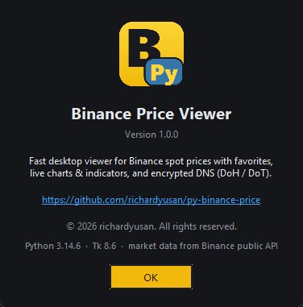

# Binance Price Viewer

**Fast, dependency-free Python desktop app for live Binance spot prices — favorites list, candlestick charts with Bollinger Bands / MA / EMA / RSI / MACD, and encrypted DNS (DoH / DoT) to get past ISP DNS blocking.**

Pure Python standard library (Tkinter + `http.client`): no `pip install`, starts in under a second.


## Features

- **Live prices for your favorite tickers**: last price, 24h change / %, high, low and quote volume. All favorites are fetched in one batched request over a keep-alive HTTPS connection on a background thread, so the UI never freezes. Refresh interval is adjustable down to 250 ms.
- **Favorites management**: add symbols with autocomplete (`BTC` → `BTCUSDT`), remove, reorder (▲/▼), sort by any column. Rows flash green/red when the price changes.
- **Price chart** (toggle with the **Chart** button or `Ctrl+G`, off by default)
  - Candles or line, intervals 1m / 5m / 15m / 1h / 4h / 1d / 1w
  - Indicators: **Bollinger Bands (20, 2)**, MA (7/25/99), EMA (12/26), Volume, RSI (14), MACD (12, 26, 9)
  - Crosshair with OHLC and indicator values, mouse-wheel zoom, live-updating last candle
- **Custom DNS resolver**: Cloudflare 1.1.1.1 (default), Google, Quad9, AdGuard, OpenDNS, system DNS or your own servers. Uses DNS over HTTPS, DNS over TLS or plain UDP.
- **Connection info bar**: connection state, API host and server IP, and the DNS server that answered.
- **Save / load configuration** as JSON in the app folder (`config.json` loads automatically on startup).
- Dark theme, high-DPI aware, custom app icon.


## Requirements

- Windows 10/11 (also runs on macOS/Linux with Python + Tk)
- [Python 3.9+](https://www.python.org/downloads/) with **tcl/tk** and the **py launcher**. Both are selected by default in the Windows installer.

No third-party packages are needed.

## Getting started (Windows)

```powershell
git clone https://github.com/richardyusan/py-binance-price.git
cd py-binance-price
```

Then start it any of these ways:

| Launcher | What it does |
|---|---|
| `BinancePriceViewer.pyw` | Double-click: runs through the Python launcher (`pyw`) without a console window |
| `run.bat` | Same, from a terminal or Explorer. `run.bat --console` keeps a console open for error output |
| `create_shortcut.ps1` | Creates Desktop and Start Menu shortcuts with the app icon |
| `py binance_viewer.py` | Run directly |

```powershell
powershell -ExecutionPolicy Bypass -File create_shortcut.ps1
```

## Usage

| Action | How |
|---|---|
| Add a favorite | Type a symbol in **Symbol** and press Enter or click **Add** |
| Remove / reorder | Select rows, then **Remove** / Delete key, or ▲ ▼ |
| Sort | Click a column header (click again to reverse) |
| Show chart | **Chart** button, **View → Show chart** or `Ctrl+G`, then click a ticker |
| Indicators | **Indicators ▾** in the chart toolbar |
| Zoom chart | Mouse wheel over the chart |
| Open on binance.com / copy price | Double-click a row, or right-click for the menu |
| Save / load config | `Ctrl+S`, `Ctrl+Shift+S`, `Ctrl+O` (File menu) |
| Connection & DNS settings | **Settings → Connection & DNS** or `Ctrl+,` |
| Refresh now | `F5` |
| About | **Help → About** or `F1` |

## Connection & DNS settings


Many ISPs block Binance by **hijacking DNS**: every lookup on port 53 is intercepted and answered with a block-page address, even when you query 1.1.1.1 directly. The app therefore resolves Binance hostnames itself through an **encrypted** resolver and then connects to that IP, still verifying the TLS certificate against the real hostname.

| Protocol | Notes |
|---|---|
| DNS over HTTPS (default) | `https://<resolver-ip>/dns-query` (RFC 8484). Falls back to DoT |
| DNS over TLS | Port 853 (RFC 7858). Falls back to DoH |
| Plain DNS (UDP 53) | Fast, but easily hijacked. Never used as an automatic fallback |

Quad9 only accepts HTTP/2 for DoH, so the app uses DoT for it automatically.

API hosts:
- `data-api.binance.vision` (default): Binance's public market-data endpoint
- `api.binance.com` / `api1-4.binance.com`: main API
- `api.binance.us`: Binance.US

Use **Test connection** to check a setup before applying it.

## Configuration file

`config.json` lives next to the app and is created when you first save. Example:

```json
{
  "favorites": ["BTCUSDT", "ETHUSDT", "BNBUSDT", "SOLUSDT", "XRPUSDT"],
  "refresh_ms": 1000,
  "api_host": "data-api.binance.vision",
  "dns_provider": "cloudflare",
  "dns_mode": "doh",
  "dns_custom": "",
  "always_on_top": false,
  "flash": true,
  "sort_column": null,
  "sort_reverse": false,
  "chart_interval": "15m",
  "chart_style": "candles",
  "show_chart": false,
  "chart_indicators": {"bb": true, "ma": false, "ema": false, "vol": true, "rsi": false, "macd": false},
  "geometry": "920x460"
}
```

| Key | Values |
|---|---|
| `dns_provider` | `cloudflare`, `google`, `quad9`, `adguard`, `opendns`, `system`, `custom` |
| `dns_mode` | `doh`, `dot`, `udp` |
| `dns_custom` | Comma-separated resolver IPs, used when `dns_provider` is `custom` |

Use **File → Save config as…** to keep several configs, for example `majors.json` and `alts.json`.

## Project layout

```
binance_viewer.py        main window: favorites table, menus, settings, about box, config
chart.py                 Canvas chart widget and indicator math (BB, SMA, EMA, RSI, MACD)
net.py                   DNS resolver (DoH / DoT / UDP), HTTPS client, background workers
BinancePriceViewer.pyw   console-less launcher (double-click)
run.bat                  batch launcher using the py launcher
create_shortcut.ps1      creates Desktop / Start Menu shortcuts
make_icon.ps1            regenerates icon.ico / icon.png
docs/screenshots/        README images
```

## About



Market data comes from the public Binance REST API. No API key or account is needed, and the app never places orders. This is not financial advice.

© 2026 richardyusan. All rights reserved. https://github.com/richardyusan/py-binance-price
